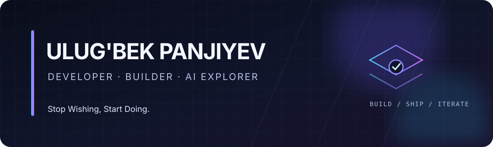

### Building ideas into real projects.

Developer · Builder · AI Explorer

**Stop Wishing, Start Doing.**

---

## About

- Exploring **AI-powered tools**, desktop applications, and web products.
- I learn by building, testing, breaking things, and improving them.
- Currently focused on **MOVRA** and practical software experiments.
- Interested in clean workflows, useful products, and open-source development.

## Featured projects

| Project | Focus |
| --- | --- |
| [Dostlar Jangi](https://github.com/Panjiyev2012/dostlar-jangi) | Game development |
| [QRShare](https://github.com/Panjiyev2012/qrshare) | QR-based sharing |
| [Football Bot](https://github.com/Panjiyev2012/fudbol-bot) | Telegram / bot experiments |

## Tech I work with

## GitHub overview

## Current focus

- Building and refining **MOVRA**.
- Improving software architecture and development workflows.
- Turning small experiments into useful, finished projects.

---

*Build. Learn. Improve. Repeat.*

